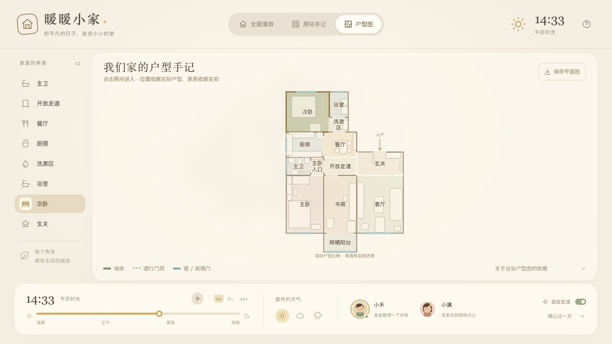
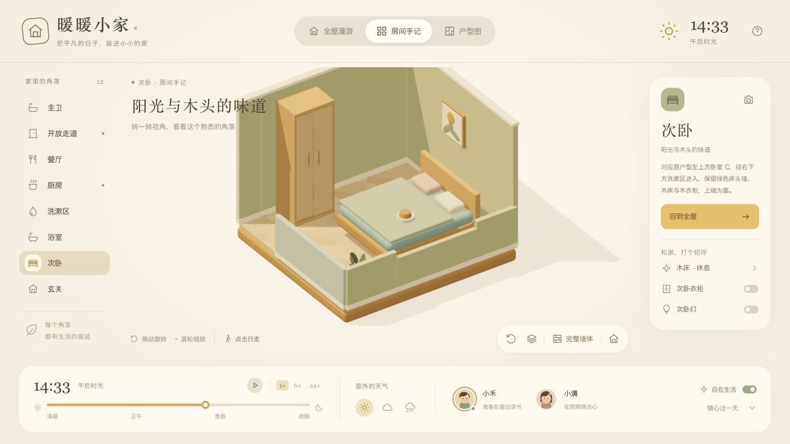
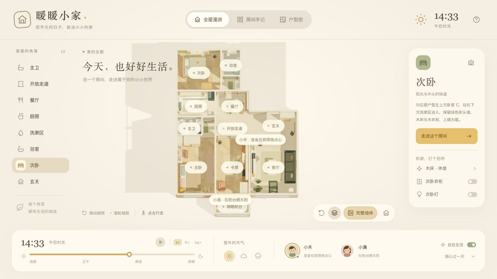
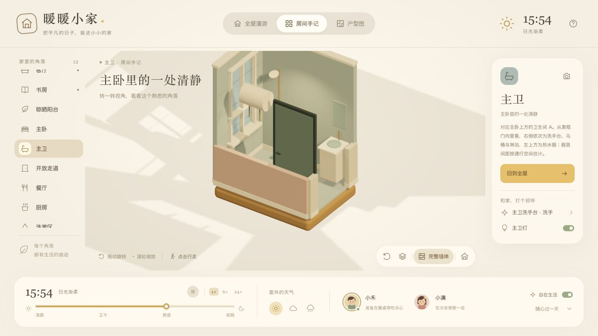

# Photo to Cozy Home

> Reconstruct a collection of family home photos into a navigable, interactive, chibi-style WebGL miniature home that changes over time.

This Skill allows users to begin reconstructing their homes simply by providing photographs of different rooms and corners.

If a floor plan is available, the Skill prioritizes it to calibrate walls, doors, windows, and dimensional relationships. Without a floor plan, it estimates spatial connections using door frames, windows, floor boundaries, and recurring furniture visible in photographs. It then asks users a small number of targeted questions that genuinely affect the layout.

**This Skill was created by GPT 6 Astra, which was also used to complete and validate its first full reference project. Other models may attempt the same workflow, but their actual completion quality, spatial reasoning capabilities, and long-running workflow stability may vary.**

## Features

- Identify rooms, furniture, doors, windows, and spatial connections from photographs to construct an evidence-annotated floor plan.
- Generate a warm-yellow, rounded, chibi-style 3D WebGL home using the same floor-plan dataset.
- Open individual rooms, rotate the camera, zoom in and out, switch to an overhead view, and toggle between full-wall and cutaway views.
- Enable visible interactions with computers, televisions, lights, desk lamps, wardrobes, sofas, and desks.
- Add a young boy and a young girl who support manual movement, autonomous activities, and simple daily routines.
- Simulate how morning, noon, sunset, nighttime, sunny weather, cloudy conditions, and rain affect indoor and outdoor lighting.
- Synchronize walls, furniture, navigation, wall decorations, cameras, and floor plans whenever users provide additional photographs or correct the layout.

## GPT 6 Astra Validation Case

The following images come from the latest validation case.

The repository contains only screenshots of the generated models. It does not include the original family photographs, addresses, or personal photographs provided by users.

### From a Complete Home Layout to an Interactive Miniature Home

The complete-home view includes room selection, character status, a timeline, weather controls, and interactive features.

Characters move within the same world-coordinate system and are not teleported when switching to an individual room view.

### Floor Plan and 3D Model Share the Same Layout Data

Room boundaries, open connections, doors, windows, furniture footprints, and the 3D model are all generated from the same dataset.

In the reference project, the layout was corrected using a floor plan subsequently provided by the user. These corrections included adjustments to the entrance, dining room, and open hallway, as well as a complete swap of the master bedroom and secondary bedroom.

### Room-Level Reconstruction

| Master Bedroom Suite | Secondary Bedroom |
| --- | --- |
|  |  |

The master bedroom preserves the sleeping area, short entrance hallway, and ensuite bathroom.

The secondary bedroom includes a wooden bed, wooden wardrobe, window, and wall decorations.

Wardrobes can be opened and closed, while wall decorations are constrained by the actual boundaries of the wall segments.

### Open Spaces and Wall Relationships

The living room, dining room, entrance, and hallway can be selected individually.

However, open connections do not generate nonexistent beams, door frames, columns, or invisible collision walls.

Shared physical walls are generated only once to prevent overlapping geometry and visual flickering.

### Ensuite Bathroom

Bathroom fixtures and the water heater are positioned according to additional viewing-angle information provided by the user.

The layout also accounts for character movement, door opening and closing, and furniture collision detection.

### Final Validation Results

The reference project's final validation included:

- All **41 automated checks passed**.
- Four fixed random seeds were used to run separate 10-minute simulations of autonomous activity involving two characters. The tests continuously checked destination arrival, spacing between characters, and collisions with walls and furniture.
- Browser-based testing verified switching between the complete home and individual rooms, camera rotation, full-wall and cutaway views, computer and lighting interactions, wardrobe opening and closing, character movement between rooms, day/night cycles, and weather effects.
- The browser console reported no errors or warnings.
- Wall decorations remained entirely within actual wall geometry, avoiding doors, windows, and open passageways.

These results represent the actual performance of the first GPT 6 Astra reference project. They are not fixed testing requirements for every home.

The Skill generates and executes appropriate validation checks based on each project's scope.

## Installation and Usage

Clone the repository into your Codex skills directory:

    git clone https://github.com/Clarklevis1995/photo-to-cozy-home.git ~/.codex/skills/photo-to-cozy-home

Then attach photographs of your home in Codex and enter:

    Use $photo-to-cozy-home to transform my home into an interactive, chibi-style 3D miniature home.

### Recommended Inputs

Users can get started with photographs alone.

However, more complete inputs generally include:

- Photographs of individual rooms and connecting areas, especially pictures taken from doorways looking into both adjoining spaces.
- An optional floor plan, room measurements, or room names.
- Optional visual references for the desired artistic style.
- Preferences for interactive furniture, character behavior, and the time simulation system.

### When No Floor Plan Is Available

If no floor plan is provided, the Skill first assembles a proposed spatial layout.

It then asks specific questions, such as:

> When standing at the bedroom doorway and looking inside, is the bathroom door directly ahead or on the right?

The Skill does not require users to complete a lengthy questionnaire before getting started.

It also does not assume that the order in which photographs were provided represents confirmed spatial connections.

## Core Design Principles

Spatial connectivity and furniture relationships take priority over decorative effects.

The Skill distinguishes between confirmed information, evidence-based inferences, and unknown information, and writes user corrections back to the same shared layout dataset.

It includes constraints designed to prevent the following common problems:

- Duplicate shared walls, conflicting wall geometry, and fictional door frames appearing in open spaces.
- Room names being changed without simultaneously updating furniture, bathrooms, and character navigation routes.
- Characters becoming permanently stuck in narrow doorways, studies, or when walking toward one another.
- Wardrobe doors passing through furniture or opening without revealing a realistic interior.
- Wall decorations extending beyond wall edges, covering doors or windows, or floating over open passageways.
- Individual room views and floor plans using inconsistent coordinate systems.

## Repository Structure

    photo-to-cozy-home/
    ├── SKILL.md
    ├── agents/openai.yaml
    ├── references/
    │   ├── reconstruction.md
    │   ├── implementation.md
    │   └── validation.md
    └── assets/showcase/

- [SKILL.md](SKILL.md): Entry point, supported use cases, workflow, and delivery requirements.
- [reconstruction.md](references/reconstruction.md): Deriving spatial layouts from photographs and optional floor plans.
- [implementation.md](references/implementation.md): WebGL modeling, furniture, characters, lighting, and interaction constraints.
- [validation.md](references/validation.md): Structural validation, navigation testing, browser testing, and final delivery acceptance scenarios.

## Privacy and Limitations

Family photographs should remain within the user's local project by default.

They should not be copied into Skill templates or uploaded without authorization.

Public demonstrations should use only generated results explicitly approved by the user and should remove addresses, personal photographs, and other identifying information.

Dimensions estimated from photographs and areas not fully captured in images are approximations.

They cannot replace professional architectural measurements, structural safety assessments, or real-world sunlight and daylight analysis.

When actual on-site measurements are unavailable, the finished project should clearly identify areas that may require further calibration.

## Model Information

**Model used for creation and first reference-project validation: GPT 6 Astra.**

Other models can load and attempt to execute this Skill directly.

When evaluating alternative models, particular attention should be paid to their performance in multi-image spatial reconstruction, global synchronization after user corrections, long-duration navigation testing involving two characters, and actual browser-based validation.
